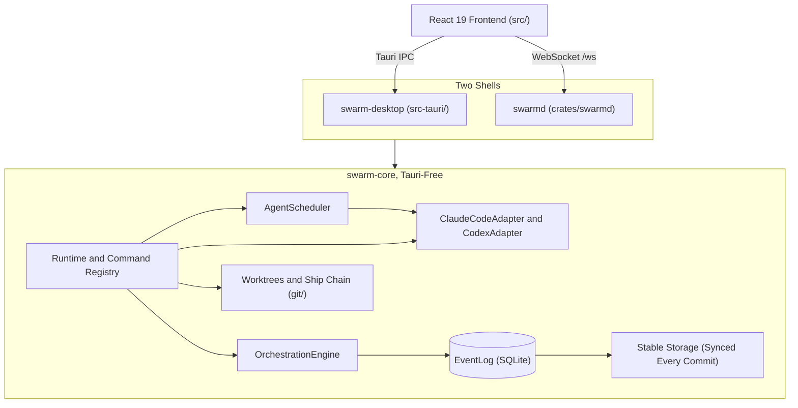

<p align="center">
  <picture>
    <source media="(prefers-color-scheme: dark)" srcset=".github/readme/hero-dark.svg" />
    
  </picture>
</p>

<p align="center"><b>Many coding agents. One ordered event stream.</b></p>

<p align="center">
  <a href="https://github.com/ABCrimson/Swarm/actions/workflows/ci.yml"></a>
  <a href="https://github.com/ABCrimson/Swarm/releases/latest"></a>
  <a href="LICENSE"></a>
  <a href="https://abcrimson.github.io/Swarm/"></a>
  <br />
  <a href="rust-toolchain.toml"></a>
  <a href="package.json"></a>
  <a href="package.json"></a>
  <a href="Cargo.toml"></a>
</p>

> [!IMPORTANT]
> **Latest release: [v0.14.0](https://github.com/ABCrimson/Swarm/releases/tag/v0.14.0) (2026-10-14)**, the first release on Tauri 3 (alpha). Its breaking changes are listed under `[0.14.0]` in [CHANGELOG.md](CHANGELOG.md). This page describes `main`; `[Unreleased]` in the changelog lists what has landed since.

## What It Is

SWARM Orchestrator supervises many coding agents at once. Each worker is a shell on its own pseudo-terminal, optionally in its own git worktree and driving Claude Code or Codex over a structured protocol. Everything that happens is an event on one ordered stream backed by a SQLite log, which the UI renders, a pull request body cites, and a headless daemon replays to remote clients. It is a Tauri 3 (alpha) desktop app with a React 19 frontend, and the same Rust core also runs headless as `swarmd`.

## What Main Does Today

The code on `main` as of this commit.

<table>
  <tr>
    <td width="50%" valign="top">
      <a href="docs/adr/0001-tauri-free-core-two-shells.md" title="ADR-0001"><br /><b>One Tauri-free core, two shells.</b></a><br />
      A Tauri 3 (alpha) desktop app and the headless <code>swarmd</code> daemon both embed the same <code>swarm-core</code> library.<br />
      <sub><a href="docs/daemon.md">The daemon guide</a></sub>
    </td>
    <td width="50%" valign="top">
      <a href="docs/adr/0013-provider-adapter-trait-pair.md" title="ADR-0013"><br /><b>Two providers behind one trait pair.</b></a><br />
      Claude Code over its stream-json control protocol and Codex over <code>codex app-server</code> both implement <code>AgentAdapter</code> and <code>AgentSession</code>.<br />
      <sub><a href="docs/adr/0016-claude-code-control-protocol.md">ADR-0016</a>, <a href="docs/adr/0017-codex-app-server-protocol.md">ADR-0017</a></sub>
    </td>
  </tr>
  <tr>
    <td width="50%" valign="top">
      <a href="docs/adr/0015-trust-tiers-closed-vocabulary.md" title="ADR-0015"><br /><b>Trust tiers that fail closed.</b></a><br />
      Three tiers, <code>restricted</code>, <code>standard</code> and <code>write_enabled</code>; absent means <code>standard</code>, and any other token is refused.<br />
      <sub><a href="#providers-and-trust-tiers">The tier table</a></sub>
    </td>
    <td width="50%" valign="top">
      <a href="docs/adr/0007-worktree-per-worker-system-git.md" title="ADR-0007"><br /><b>A worktree per worker, never force-removed.</b></a><br />
      A worker can get its own locked git worktree on a <code>swarm/</code> branch; removal never forces, and a dirty tree is preserved.<br />
      <sub><a href="docs/adr/0008-worktree-removal-never-forces.md">ADR-0008</a></sub>
    </td>
  </tr>
  <tr>
    <td width="50%" valign="top">
      <a href="docs/adr/0009-ship-chain-structural-guarantees.md" title="ADR-0009"><br /><b>A ship chain bound to the commit sha.</b></a><br />
      Commit, push, then a prefilled GitHub compare page. The push sends the commit sha it resolved and is never forced, and every attempt ends in one <code>ship_settled</code> receipt.<br />
      <sub><a href="docs/architecture.md#ship-chain">Architecture: Ship Chain</a></sub>
    </td>
    <td width="50%" valign="top">
      <a href="docs/adr/0039-event-log-flushes-every-commit.md" title="ADR-0039"><br /><b>An event log flushed every commit.</b></a><br />
      A persistent event is on stable storage before it is emitted, and a block of seqs before its first seq is issued, on storage that honours fsync. Ephemeral events such as terminal output are never stored.<br />
      <sub><a href="#the-event-log-guarantee">The guarantee and its cost</a></sub>
    </td>
  </tr>
</table>

Also on `main`:

- **Claude Code sessions trust no repo configuration.** A Claude Code session loads no settings file (`--setting-sources ""`), and both provider CLIs are found only on absolute `PATH` entries ([ADR-0038](docs/adr/0038-agent-provider-trust-model.md)).
- **A kill stops the provider session first**, then the worker's shell and worktree ([ADR-0040](docs/adr/0040-kill-stops-the-session-first.md)).
- **A browser build that gates desktop-only controls.** The `pnpm build:web` bundle, served by `swarmd --serve-ui`, reads the transport's capability flags and hides or disables controls that need the desktop app ([daemon guide: What the Browser Build Offers](docs/daemon.md#what-the-browser-build-offers), [ADR-0024](docs/adr/0024-transport-chosen-at-build-time.md)).
- **React Compiler on Oxc.** The compiler, TypeScript stripping, JSX and Fast Refresh run in one pass through `oxc-transform-react`, with a WASI fallback binding ([ADR-0032](docs/adr/0032-react-compiler-oxc-wasi.md)).
- **Temporal for dates**, with `temporal-polyfill` loaded at boot only when the runtime lacks `Temporal` ([ADR-0031](docs/adr/0031-temporal-polyfill-boot-entry.md)).

## Architecture



One Rust core, two shells. `swarm-desktop` forwards Tauri IPC calls to the core; `swarmd` serves the same 36 registry commands and the event stream over an authenticated WebSocket (the desktop app has 39: three native commands, `NATIVE_ONLY`, need the webview or the OS), and the frontend reaches it with the `pnpm build:web` bundle. CI checks that `cargo tree -p swarm-core` and `cargo tree -p swarmd` contain no `tauri` crate. Full reference: [docs/architecture.md](docs/architecture.md).

## Providers and Trust Tiers

Each worker's tier maps onto the provider's own permission settings ([ADR-0015](docs/adr/0015-trust-tiers-closed-vocabulary.md)). Absent means `standard`; any other token is refused.

| Tier | What it maps to |
| --- | --- |
| `restricted` | **Claude Code:** `--restricted`, `--permission-mode dontAsk`, deny list for `Bash, PowerShell, Write, Edit, NotebookEdit, EnterWorktree, ExitWorktree, DesignSync, WebSearch, PushNotification`<br />**Codex:** `untrusted` approvals, `read-only` sandbox |
| `standard` | **Claude Code:** `--permission-mode manual`, deny list of `EnterWorktree`, `ExitWorktree` and destructive Bash patterns<br />**Codex:** `untrusted` approvals, `workspace-write` sandbox |
| `write_enabled` | **Claude Code:** `--permission-mode acceptEdits`, the same deny list as `standard`<br />**Codex:** `on-request` approvals, `workspace-write` sandbox |

No tier maps to Claude Code's `bypassPermissions`, and the Codex types have no `never` or `danger-full-access` variants, so those values cannot be put on the wire.

Per [ADR-0038](docs/adr/0038-agent-provider-trust-model.md), a Claude Code session loads no repo settings (`--setting-sources ""`). SWARM reads only the `permissions.deny` string entries from `<cwd>/.claude/settings.json` and appends them, in file order and up to 8 KiB of JSON, to the tier's deny list (at the first entry that does not fit, that entry and all later ones are dropped): a repo can narrow a session and nothing else. The Bash deny patterns are a convenience fence, not the gate; the gate is the permission mode plus the human.

## The Event Log Guarantee

The decision, verbatim from [ADR-0039](docs/adr/0039-event-log-flushes-every-commit.md):

> `EventLog::init` sets `PRAGMA synchronous = EXTRA` and `PRAGMA fullfsync = 1` on the writer connection, reads both back (neither pragma echoes its value) and fails the open with `AppError::EventLog` unless they read 3 and 1. In WAL mode EXTRA is FULL: each event append and each seq reservation is its own committed transaction and syncs the `-wal` file before the writer goes on, so an event is on stable storage before it is emitted and a block of seqs before its first seq is issued.

The cost, as measured on 2026-10-13 on an Intel Core Ultra 9 290HX Plus under WSL2 (Ubuntu-26.04, ext4 on a VHD), 3000 appends of a 392-byte payload: the shipped `synchronous=EXTRA` ran at 463 and 492 events/s (two runs, p50 2.2 to 2.4 ms), within run-to-run noise of `FULL` at 469 to 514 events/s (p50 1.97 to 2.19 ms), against 23219 to 31606 events/s at `NORMAL`. Native Windows NTFS and macOS (`F_FULLFSYNC`) are unmeasured. Method and the full table: [docs/performance.md](docs/performance.md#event-log-persistence).

## Install and Run

Prerequisites, from `package.json`, `rust-toolchain.toml`, [docs/contributing.md](docs/contributing.md), `MIN_GIT_VERSION` in `crates/swarm-core/src/git/cli.rs` and `minimumSystemVersion` in `src-tauri/tauri.conf.json`:

- **pnpm** at the version in `packageManager` (`pnpm@12.13.0`).
- **Node.js** at the nightly pinned in `engines.node` and `devEngines.runtime` (`onFail: download`); per docs/contributing.md, pnpm downloads it, so do not install it separately.
- **Rust** at the nightly pinned by `rust-toolchain.toml`; any `cargo` command in the repo installs it.
- **git 2.32 or newer** (a startup probe reports older versions).
- **macOS 15.4 or newer** to run the desktop app on macOS ([ADR-0037](docs/adr/0037-webkit-floor-and-macos-15-4.md)).

Desktop app, from a clone:

```bash
pnpm install
pnpm tauri:dev      # builds the Rust core and launches the desktop app
```

Headless daemon with the browser UI, from the repository root ([docs/daemon.md](docs/daemon.md)):

```bash
pnpm build:web                       # the browser bundle, output in dist-web/
cargo build -p swarmd --release      # binary at target/release/swarmd (swarmd.exe on Windows)
target/release/swarmd --serve-ui dist-web
```

`swarmd` binds `127.0.0.1:8787` by default. When stdout is a terminal it prints the connect URL, `http://127.0.0.1:8787/#t=<token>`; otherwise `swarmd connect-url` prints it. Without `--serve-ui`, a WebSocket client connects to `ws://127.0.0.1:8787/ws`.

> [!WARNING]
> The token is the only authentication and the WebSocket is plain `ws://`. Do not put `--bind 0.0.0.0:PORT` on the open internet; reach a remote daemon through an SSH tunnel or a reverse proxy that terminates TLS ([daemon guide](docs/daemon.md#reaching-the-daemon-off-box)).

Released binaries (desktop installers and `swarmd`) are attached to the [v0.14.0 release](https://github.com/ABCrimson/Swarm/releases/tag/v0.14.0).

## Roadmap At A Glance

The plan starts from 0.14.0, released 2026-10-14. 1.0.0 is a compatibility and trust promise, not a claim that more agents produce better work; that is measured in 1.1.0. Each major's outcome, scope and acceptance evidence: [docs/roadmap.md](docs/roadmap.md#the-ten-majors-at-a-glance).

<p align="center">
  <picture>
    <source media="(prefers-color-scheme: dark)" srcset=".github/readme/roadmap-dark.svg" />
    
  </picture>
</p>

## Docs

Also published at <https://abcrimson.github.io/Swarm/>.

| Page | Summary |
| --- | --- |
| [API Reference](docs/api.md) | The command, event and wire-protocol contract of the backend: 39 commands, one ordered event stream, two transports. |
| [Architecture](docs/architecture.md) | The current-state reference: how the system is put together at this commit. |
| [Contributing](docs/contributing.md) | Development setup, code standards, and contribution guidelines. |
| [The `swarmd` Daemon](docs/daemon.md) | Running SWARM Orchestrator headless, as a per-user background program reachable over an authenticated WebSocket. |
| [End-to-End Testing](docs/e2e.md) | Playwright coverage for the frontend shell, its hard boundary, and the documented (not yet built) path past it. |
| [Performance Architecture](docs/performance.md) | Performance targets, budgets, and implementation details. |
| [Roadmap](docs/roadmap.md) | The next ten major releases and the minor releases between them, as planned on 2026-10-13. |
| [Updater Keys](docs/updater-keys.md) | How the in-app updater is signed: the Ed25519 keypair, the CI signing flow, signed-version enforcement, and how each Linux bundle would update. |

Decision records are indexed in [docs/adr/README.md](docs/adr/README.md).

## Gates

The commands a change must pass, copied from [AGENTS.md](AGENTS.md#gates).

<details>
<summary>Frontend, Rust and Workflow Gates</summary>

Frontend (all must pass):

```bash
pnpm install --frozen-lockfile
pnpm typecheck          # tsconfig.json, tsconfig.worker.json, tsconfig.node.json
pnpm exec biome ci .
pnpm test:coverage      # Vitest plus the coverage floor in vitest.config.ts
pnpm build              # also: pnpm build:web
pnpm check:compiler     # also: NAPI_RS_FORCE_WASI=true pnpm check:compiler
pnpm exec knip --treat-config-hints-as-errors   # dead code / unused deps (knip.jsonc)
pnpm test:e2e --shuffle # Playwright (chromium; webkit and firefox are opt-in projects)
pnpm build:site         # docs site
```

Rust (from the repo root):

```bash
cargo fmt --all --check
cargo clippy --workspace --all-targets --locked -- -D warnings
cargo test --workspace --locked --all-targets
cargo test --locked --doc -p swarm-core -p swarmd   # doctests: Tauri-free crates only (ci.yml says why)
cargo deny check
# plus: cargo tree -p swarm-core / -p swarmd must contain no tauri crate (ci.yml rust-policy)
```

Workflows (the `workflows` job of `ci.yml`; run it when you touch `.github/`):

```bash
actionlint              # the version pinned in ci.yml
zizmor .github          # the version pinned in ci.yml; set GH_TOKEN so the online audits (pinned SHA vs its # vX.Y.Z comment, known-vulnerable actions) run as they do in CI
```

CI gathers every job into the single required status `CI OK`.

</details>

<details>
<summary>Pinned Versions At This Commit</summary>

| Component | Pin | Source |
| --- | --- | --- |
| App | 0.14.0 | `package.json` |
| pnpm | 12.13.0 | `package.json` `packageManager` |
| Node.js | 27.0.0-nightly202610123b639be3a4 | `package.json` `devEngines.runtime` |
| Rust toolchain | nightly-2026-10-14 (`rust-version` 1.101, edition 2024) | `rust-toolchain.toml`, `Cargo.toml` |
| Tauri | 3.0.0-alpha.4 (`tauri`, `tauri-runtime-wry`) | `Cargo.toml` |
| React | 19.3.1 | `package.json` |
| TypeScript | 7.1.0-dev.20261014.1 | `package.json` |
| Vite | 8.3.4 | `package.json` |
| Biome | 2.5.15 | `package.json` |
| Vitest | 5.0.4 | `package.json` |
| Playwright | 1.65.0-alpha-2026-10-14 | `package.json` |

</details>

## Security

Do not open a public issue for a vulnerability. Report it through [GitHub Security Advisories](https://github.com/ABCrimson/Swarm/security/advisories/new) or by email to security@crimson.dev, as described in [SECURITY.md](SECURITY.md).

## Contributing

Setup, standards and the pull request process are in [docs/contributing.md](docs/contributing.md). House rules from [AGENTS.md](AGENTS.md), which `CLAUDE.md` imports: pnpm is the only package manager, every dependency version is pinned exactly, and Biome is the only frontend linter and formatter.

## License

[MIT](LICENSE). Copyright (c) 2026 Albert Badalov.
