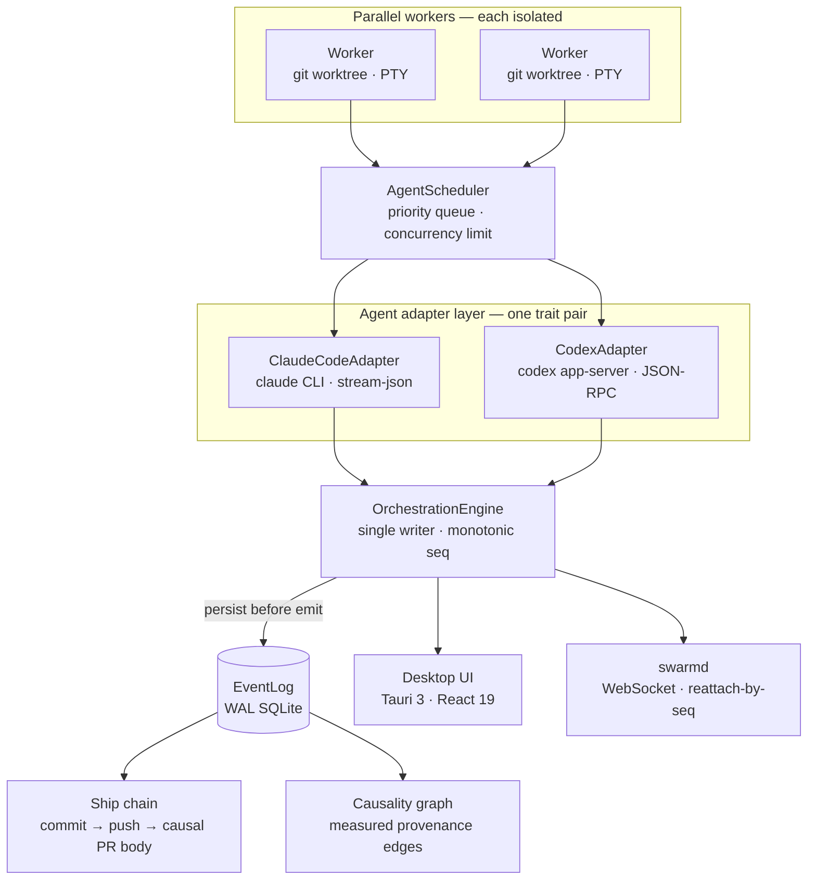

<p align="center">
  
</p>

<p align="center">
  
  <a href="https://github.com/ABCrimson/Swarm/actions/workflows/ci.yml"></a>
  
  
  
  
  
  <a href="LICENSE"></a>
</p>

<p align="center">
  <a href="#what-is-swarm">What</a> &middot;
  <a href="#what-makes-it-different">Why</a> &middot;
  <a href="#architecture">Architecture</a> &middot;
  <a href="#quick-start">Quick Start</a> &middot;
  <a href="#the-swarmd-daemon">The Daemon</a> &middot;
  <a href="https://abcrimson.github.io/Swarm/">Docs ↗</a> &middot;
  <a href="CHANGELOG.md">Changelog</a>
</p>

---

## What is SWARM?

**SWARM Orchestrator** runs many AI coding agents in parallel — each in its own **isolated git worktree**, on its own **PTY**, feeding a **single ordered event log** that makes every action monotonically sequenced and causally traceable. A Rust core drives a React 19 frontend on Tauri 3 (alpha); the same core also runs **headless as a daemon** you can reattach to remotely, replaying the exact event stream from any sequence number.

It's a complete agent **product loop** — spawn in isolation, watch in real time, and ship the result through a `commit → push → PR` chain whose pull-request body is generated from the actual turns that produced the diff.

```bash
# desktop
pnpm tauri:dev
# or headless
swarmd            # binds 127.0.0.1:8787, prints a connect URL with a token
```

---

## What makes it different

Parallel-agent orchestrators are a crowded idea. SWARM's wager is that the **substrate** is what matters — a single, ordered, replayable spine that everything else is derived from, not bolted onto.

| | How SWARM does it |
|---|---|
| **One ordered spine** | A single-writer `OrchestrationEngine` assigns a monotonic `seq` to every event and **persists before it emits** to a WAL SQLite log. There is exactly one source of truth for what happened and in what order. |
| **Causal provenance, measured — not guessed** | Every event carries an optional `{originWorker, causeSeq}` envelope. The causality graph is built from **real** edges in the data, not a fabricated "spawn order." |
| **Machine-verifiable ship bodies** | The `commit → push → compare` chain writes a **Causal Record** into the PR body — a deterministic, code-generated table of the exact turns and tool calls (by `seq` range) that produced the diff. Unforgeable, and honest about what it can't see. |
| **Two providers, one unchanged trait** | `ClaudeCodeAdapter` (the `claude` CLI's `stream-json`) and `CodexAdapter` (the `codex` app-server's bidirectional JSON-RPC) implement the *same* `AgentAdapter`/`AgentSession` traits with **zero signature changes** between two structurally opposite protocols. |
| **Headless, reattachable** | `swarmd` serves the identical core over an authenticated WebSocket. A remote client **reattaches by replaying the log from a sequence number** — a reconnect resumes exactly where it left off. |
| **Drift-proof command surface** | A single command `Registry` (36 commands) backs both the Tauri shell and the daemon; contract tests compare the shell's `commands!` name lists with the Registry's and fail the build if the two ever diverge. Remote calls are gated per-command by a declarative `RemotePolicy`. |

---

## Highlights

- **🧩 Multi-agent orchestration** — spawn, pause, resume, and kill workers with real-time state across a concurrent registry (default **64** workers, configurable up to **256**).
- **🌳 Worktree-per-worker isolation** — each worker spawns in its own `git worktree` on a `swarm/*` branch; a dirty tree is preserved, never force-removed.
- **🚢 Ship chain** — `commit → push → prefilled compare page`, with `Swarm-Seq-Range` trailers and the machine-generated Causal Record PR body.
- **🔌 Multi-provider agents** — Claude Code and Codex today, behind a trait pair designed to absorb the next provider without touching the scheduler.
- **🛰️ `swarmd` daemon** — no webview, no Tauri link-time dependency; WebSocket transport, reattach-by-seq-replay, token + Origin + Host auth, and per-user autostart units: systemd (Linux), launchd (macOS) and a logon Scheduled Task (Windows).
- **🖥️ Integrated terminal per worker** — a real PTY (`portable-pty`) bridged to Tokio, rendered with `@xterm/xterm`'s WebGL2 renderer.
- **📊 Real-time metrics** — CPU, memory, throughput, and scheduler depth via Recharts on a 500 ms loop, with a per-worker process breakdown.
- **✨ WebGPU particle system** — GPU compute shaders with adaptive particle counts (2 K–10 K, auto-tuned to GPU frame time) and bloom / chromatic-aberration / vignette post-processing.
- **⌨️ Keyboard-first** — a frecency-ranked command palette powered by [`modern-cmdk`](https://github.com/ABCrimson/modern-cmdk).
- **🎨 OKLCH design system** — every color derives from the OKLCH perceptual space.

---

## Architecture

Many parallel workers converge onto **one ordered spine**; everything downstream — the desktop UI, remote daemon clients, the ship chain, and the causality graph — is a projection of that single log.



The Rust side is a **three-crate workspace**: `swarm-core` (tauri-free domain logic), `swarmd` (the headless daemon), and `swarm-desktop` (the thin Tauri shell). Both shells call the *same* core through the *same* command `Registry`. Full detail in [`docs/architecture.md`](docs/architecture.md).

---

## Quick Start

### Prerequisites

| Tool | Version | Notes |
|---|---|---|
| Node.js | 27.0.0-nightly202610086d5e309871 | pinned via `devEngines.runtime`; pnpm downloads it for the project |
| pnpm | 12.11.2 | pinned via `packageManager`; pnpm switches itself to it |
| Rust | nightly-2026-10-10 | auto-configured by `rust-toolchain.toml` |

### Desktop

```bash
git clone https://github.com/ABCrimson/Swarm.git
cd Swarm

pnpm install
pnpm tauri:dev      # builds the Rust core and launches the desktop app
```

Production bundles:

```bash
pnpm tauri:build --no-sign    # local, unsigned; installers land in target/release/bundle/
```

Without `--no-sign` the build also signs the updater artifacts and needs `TAURI_SIGNING_PRIVATE_KEY` (see [docs/updater-keys.md](docs/updater-keys.md)); the release workflow supplies it.

Tagged releases (`v*`) build signed installers for **Windows, macOS (Intel + Apple Silicon), and Linux (`.deb` + `.AppImage`)** and attach the standalone `swarmd` binary for each target — see [`.github/workflows/release.yml`](.github/workflows/release.yml).

---

## The `swarmd` daemon

`swarmd` runs the identical core with **no webview and no `tauri` link-time dependency** — a separate binary, not a `--headless` flag. It serves the command surface and the event stream over an authenticated WebSocket, and a reconnecting client resumes by replaying the log from its last `seq`.

```bash
swarmd                       # binds 127.0.0.1:8787 by default
# → SWARM Daemon Listening On http://127.0.0.1:8787/#t=<token>
```

- **Loopback-first & token-gated** — the token lives only in the URL fragment; a non-loopback bind is refused on a data directory that has never minted a token.
- **`RemotePolicy` at the boundary** — `read_file`/`write_file` are denied over the wire and config reads are secret-filtered, so a remote client can't exfiltrate the daemon token or arbitrary files.
- **Ships as a service** — per-user units for **systemd** (Linux), **launchd** (macOS), and a **logon Scheduled Task** (Windows), all non-elevated and loopback-only by default.

> [!WARNING]
> The token is the **only** authentication and the WebSocket is plain `ws://` — never expose `--bind 0.0.0.0` to the open internet. Reach a remote daemon through an SSH tunnel or a TLS-terminating reverse proxy instead ([off-box guide](docs/daemon.md#reaching-the-daemon-off-box)).

Full operator guide: [`docs/daemon.md`](docs/daemon.md).

---

## Tech Stack

<details>
<summary><strong>Frontend</strong></summary>

| Layer | Technology | Version |
|---|---|---|
| Desktop shell | Tauri (CLI · JS API) | 3.0.0-alpha.4 · 3.0.0-alpha.2 |
| UI | React | 19.3.0-canary-b618bbb4-20261007 |
| Language | TypeScript | 7.1.0-dev.20261010.1 (native compiler) |
| Build | Vite (Rolldown) | 8.3.4 (oxc minify) |
| Compiler | React Compiler: Oxc (`oxc-transform-react`, native binding with a WASI fallback) | 0.153.0 |
| Styling | Tailwind CSS (v4 insiders) | 0.0.0-insiders.de2255b |
| State | Zustand / Jotai / Immer | 5.0.15 / 3.0.1 / 11.1.21 |
| Validation | Zod | 4.6.5 |
| Graph | @xyflow/react + elkjs | 12.12.0 / 0.12.0 |
| Terminal | @xterm/xterm | 6.1.0-beta.304 |
| Charts / Motion | Recharts / motion | 3.11.0-canary.5 / 14.1.0 |
| Lint · Test · E2E | Biome / Vitest / Playwright | 2.5.15 / 5.0.3 / 1.65.0-alpha-2026-10-10 |

</details>

<details>
<summary><strong>Backend</strong></summary>

| Layer | Technology | Version |
|---|---|---|
| Language | Rust | nightly-2026-10-10 (rustc 1.101.0-nightly) |
| Async runtime | Tokio | 1.53.2 |
| Daemon transport | axum (WebSocket) | 0.8.9 |
| Event log | rusqlite (bundled, WAL) | 0.40.2 |
| Concurrency | DashMap / parking_lot | 7.0.0-rc2 / 0.12.5 |
| Static UI serving (swarmd) | tower-http | 0.7.1 |
| PTY | portable-pty | 0.9.0 |
| Errors / Tracing | thiserror + anyhow / tracing | 2.0.21 + 1.0.104 / 0.1.44 |
| Sysinfo | sysinfo | 0.39.6 |

</details>

---

## Project layout

<details>
<summary><strong>Three-crate workspace</strong></summary>

```text
Swarm/
├── .github/
│   ├── assets/                 # the README hero
│   └── workflows/              # CI + four-platform release pipeline
├── src/                        # React 19 frontend
├── src-tauri/                  # swarm-desktop — the thin Tauri shell (command Registry forwarders)
├── crates/
│   ├── swarm-core/             # tauri-free domain core:
│   │   └── src/{agent,bus,commands,events,git,orchestration,session,worker}/
│   └── swarmd/                 # headless daemon: ws.rs, auth.rs, serve_ui.rs + service/ units
├── docs/                       # architecture · api · daemon · e2e · performance · contributing
│   ├── history/                # the original build spec (SWARM_NEW.md), archived
│   └── superpowers/plans/      # dated execution plans, archived
├── e2e/                        # Playwright specs
├── package.json                # frontend deps + scripts
└── CHANGELOG.md
```

</details>

---

## Status

**v0.13.1** — published across four platforms with standalone `swarmd` binaries. The full beyond-T3 product loop is live: worktree isolation, the causal ship chain, the provenance/causality spine, two agent providers behind one trait, and the headless daemon. See the [changelog](CHANGELOG.md) for the per-release detail.

---

## Contributing & License

Development setup, code standards, and the review process live in [`docs/contributing.md`](docs/contributing.md). Licensed under the [MIT License](LICENSE).
